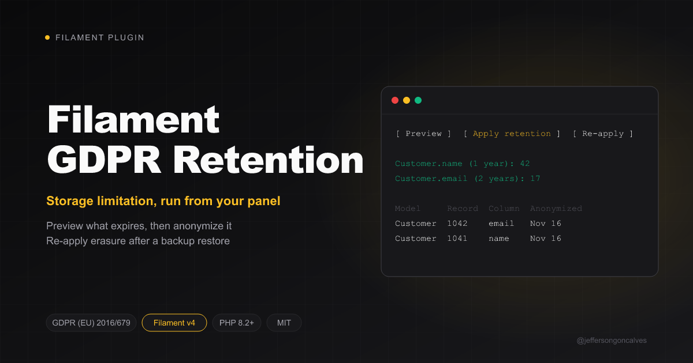

<div class="filament-hidden">



</div>

# Filament GDPR Retention

[](https://packagist.org/packages/jeffersongoncalves/filament-gdpr-retention)
[](https://github.com/jeffersongoncalves/filament-gdpr-retention/actions?query=workflow%3Atests+branch%3A2.x)
[](https://github.com/jeffersongoncalves/filament-gdpr-retention/actions?query=workflow%3A"Fix+PHP+code+styling"+branch%3A2.x)
[](https://packagist.org/packages/jeffersongoncalves/filament-gdpr-retention)
[](LICENSE.md)

The Filament panel for [laravel-gdpr-retention](https://github.com/jeffersongoncalves/laravel-gdpr-retention). Under the GDPR, personal data is kept no longer than necessary (storage limitation, Art. 5(1)(e)). This page lets you see what is due, run the retention, and erase again the data a restored backup brought back.

## Features

- **Preview:** how many records would be anonymized now, per model and column. Nothing is changed.
- **Apply retention:** anonymizes every column whose period has ended, each with its own strategy.
- **Re-apply after backup:** anonymizes again the columns that a restored backup brought back.
- The list of anonymized columns (tombstones), filterable by model and column. Tombstones hold no personal data.
- English (more languages coming).

## Compatibility

| Plugin Version                                                                | Filament |
|-------------------------------------------------------------------------------|----------|
| [1.x](https://github.com/jeffersongoncalves/filament-gdpr-retention/tree/1.x) | 3.x      |
| [2.x](https://github.com/jeffersongoncalves/filament-gdpr-retention/tree/2.x) | 4.x      |
| [3.x](https://github.com/jeffersongoncalves/filament-gdpr-retention/tree/3.x) | 5.x      |

## Installation

You can install the package via composer:

```bash
composer require jeffersongoncalves/filament-gdpr-retention:"^2.0"
php artisan vendor:publish --tag="gdpr-retention-migrations"
php artisan migrate
```

## Usage

```php
use JeffersonGoncalves\Filament\GdprRetention\GdprRetentionPlugin;

public function panel(Panel $panel): Panel
{
    return $panel
        ->plugins([
            GdprRetentionPlugin::make()
                ->navigationGroup('GDPR')             // default: no group
                ->navigationSort(30)
                ->navigationIcon('heroicon-o-clock')
                ->slug('data-retention'),
        ]);
}
```

All fluent methods are optional. The buttons run in the web request: keep `php artisan gdpr:retention` scheduled daily as the main way to apply retention, and use the panel to check and to act after a restore.

> The resource has no authorization of its own: register it only on panels whose users may erase personal data, or add a policy for `JeffersonGoncalves\GdprRetention\Models\Tombstone`.

## Related plugins

- [filament-gdpr](https://github.com/jeffersongoncalves/filament-gdpr): personal data inventory, with each column's retention.
- [filament-gdpr-consent](https://github.com/jeffersongoncalves/filament-gdpr-consent): consent ledger.
- [filament-gdpr-dsar](https://github.com/jeffersongoncalves/filament-gdpr-dsar): data subject requests (Arts. 15 to 22).

## Testing

```bash
composer test
```

## Changelog

Please see [CHANGELOG](CHANGELOG.md) for more information on what has changed recently.

## Contributing

Please see [CONTRIBUTING](.github/CONTRIBUTING.md) for details.

## Security Vulnerabilities

Please review [our security policy](../../security/policy) on how to report security vulnerabilities.

## Credits

- [Jefferson Gonçalves](https://github.com/jeffersongoncalves)
- [All Contributors](../../contributors)

## License

The MIT License (MIT). Please see [License File](LICENSE.md) for more information.
